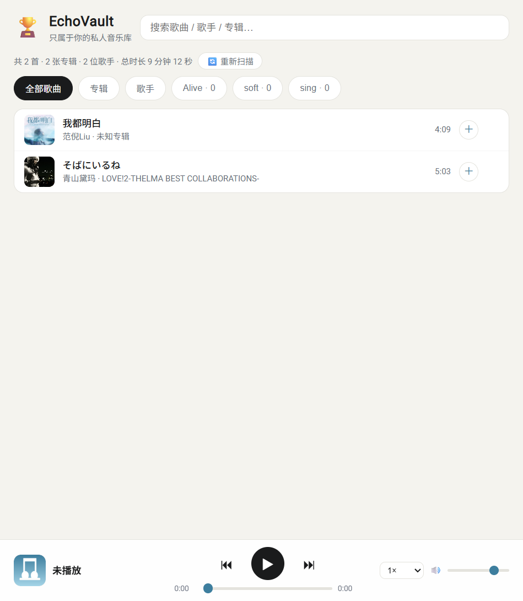

# 🏆 EchoVault

**只属于你自己的私人音乐库** —— 自托管音乐播放器，只播你保存在本地的歌，不依赖任何厂商曲库。


---

## ✨ 为什么用它

- 🎧 **只播自己的歌**：音乐文件全在你手里，没有任何平台的版权、会员、加密限制
- 📱 **多端访问**：Android 手机 + Windows 电脑浏览器，PWA 添加到主屏幕，体验像原生 App
- 🔐 **数据主权**：你的音乐、你的服务器，不经过任何第三方
- 🕐 **7×24 在线**：部署到云服务器后随时随地听，手机锁屏也能控制（Media Session）
- 🐳 **零版权风险**：音乐永远留在你的硬盘/服务器，代码与数据分离，永不进 Git

## 🚀 功能特性

| 类别 | 能力 |
| --- | --- |
| 🗂️ 曲库 | 自动扫描 `music` 目录（支持子文件夹），格式：`mp3 / flac / m4a / aac / ogg / opus / wav` |
| 🏷️ 元数据 | 读取 ID3 标签（标题/歌手/专辑/年份/流派/封面）；无标签文件自动从文件名解析歌手/标题 |
| 🖼️ 封面 | 三级兜底：**内嵌封面 → 同名图片配对 → cover.jpg 目录兜底**，每首歌都能有自己的封面 |
| 🔄 自动更新 | 往音乐目录放歌后约 20 秒自动入库（增/删/改都能感知），无需重启 |
| 🔍 浏览 | 全部歌曲 / 专辑 / 歌手三种视图 + 全局搜索 |
| ▶️ 播放 | 播放队列、进度拖动（HTTP Range 206）、倍速 0.5–2×、音量记忆、键盘快捷键 |
| 📱 PWA | 离线壳 + 添加到主屏幕 + Android 锁屏媒体控制 |
| 🐳 部署 | Docker 一键上云，音乐存挂载目录、代码存镜像，数据与代码分离 |

## 📸 界面预览



## ⚡ 快速开始（Windows 本地）

```powershell
cd EchoVault
.\run.ps1
```

脚本自动创建虚拟环境、安装依赖并启动服务，浏览器打开 `http://localhost:8848`。

手动启动：

```powershell
python -m venv .venv
.\.venv\Scripts\pip install -r server\requirements.txt
.\.venv\Scripts\python -m uvicorn server.app:app --host 0.0.0.0 --port 8848
```

## ⚙️ 配置（config.json）

| 字段 | 默认值 | 说明 |
| --- | --- | --- |
| `music_dir` | `music` | 音乐文件夹（支持绝对路径） |
| `host` | `0.0.0.0` | `0.0.0.0` 局域网/公网可访问；`127.0.0.1` 仅本机 |
| `port` | `8848` | 服务端口 |
| `filename_format` | `title-artist` | 文件名解析规则：`title-artist`（`晴天 - 周杰伦.mp3`）/ `artist-title`（`周杰伦 - 晴天.mp3`）/ `none` 关闭 |

## 🖼️ 封面机制（核心设计）

```
内嵌封面（mp3 自带 APIC）  →  同名图片（01 晴天.mp3 ↔ 01 晴天.jpg）  →  cover.jpg / folder.jpg 兜底
```

- **同名配对**：图片与 mp3 同名即自动关联（`01 晴天.mp3` ↔ `01 晴天.jpg`），去掉曲目号也能匹配（`晴天.jpg`）
- **目录兜底**：没有专属图时自动使用 `cover.jpg` / `folder.jpg` / `front.jpg`
- **封面怎么来**：多数下载的 mp3 不带封面时，自己找一张专辑封面图存成同名 jpg 即可（无需写入 mp3 文件）
- **封面只用于显示，不会修改你的音乐文件**
- **体检工具**：`tools/check_cover.py` 可查看任意音频文件是否内嵌封面、提取元数据信息

## 📡 API 一览

| 接口 | 说明 |
| --- | --- |
| `GET /api/library?q=` | 曲库列表（支持搜索） |
| `GET /api/albums` | 按专辑分组 |
| `GET /api/artists` | 按歌手分组 |
| `GET /api/stats` | 曲库统计 |
| `GET /api/cover/{id}` | 封面图 |
| `GET /api/stream/{id}` | 音频流（HTTP Range 拖动） |
| `POST /api/rescan` | 重新扫描 |

## ☁️ 部署到云端（Docker）

音乐**永不进 Git**（`.gitignore` 已锁定 `music/` 与全部音频格式），代码与数据分离：

```
本地代码 --git push--> GitHub --git clone--> 云服务器 --docker compose--> EchoVault
                                            ↑
                                    音乐直接传进项目内 ~/echovault/music
```

详细步骤见 **[DEPLOY.md](DEPLOY.md)**（Docker 部署 / 传歌 / 国内加速 / 安全加固 / 备份）。

```bash
# 服务器上四行搞定（音乐目录就在项目里）
git clone https://github.com/leetcode97/-EchoVault.git echovault
cd echovault
mkdir -p music
docker compose up -d --build
```

```bash
# 传歌（增量，只传新增/改动的，20 秒自动入库）
rsync -avP "本地music路径/" root@服务器IP:~/echovault/music/
```

- **国内服务器加速**：Dockerfile 已内置阿里云 PyPI 源；Docker 镜像加速器配置见 DEPLOY.md，构建从十几分钟降到 1 分钟内
- **放行端口**：云服务商安全组放行 TCP `8848` 后，手机/电脑访问 `http://服务器IP:8848`
- **日常加歌**：本地下载新歌 → rsync 或 SFTP 拖进服务器 `music/` → 20 秒后自动入库，不用碰 Docker

## 📁 项目结构

```
EchoVault/
├── server/          # FastAPI 后端
│   ├── app.py       # 路由与静态服务
│   ├── scanner.py   # 扫描 + 标签/封面 + 缓存
│   └── requirements.txt
├── web/             # 前端 PWA（原生 HTML/CSS/JS）
│   ├── index.html / app.js / style.css
│   ├── manifest.json / sw.js / icons/
├── music/           # 你的音乐（不入 git）
├── tools/           # 辅助工具
│   └── check_cover.py   # 封面/元数据体检
├── docs/            # 文档与截图
├── config.json      # 配置
├── run.ps1          # Windows 一键启动
├── DEPLOY.md        # 服务器部署指南
├── Dockerfile / docker-compose.yml
└── .gitignore       # 已锁定 music/ 与音频格式
```

## 🛠️ 技术栈

**FastAPI**（Python）· **原生 PWA**（HTML/CSS/JS + Service Worker）· **mutagen**（元数据）· **Docker Compose**

后端零数据库依赖：曲库缓存 JSON 于 `.cache/`，文件变更自动感知，轻量到一台低配服务器能同时跑多个服务。

## ⚖️ 版权说明

本项目**只播放你自己合法拥有的音乐文件**。代码可自由使用；音乐数据（`music/`）与音频格式文件已被 `.gitignore` 锁定，**不会也不应**提交到任何公开仓库。音乐的获取、存储、使用请遵守所在地法律法规与版权规定。

## 🗺️ Roadmap

- [x] 曲库扫描 / 元数据 / 封面三级兜底 / 流式播放
- [x] 搜索 / 专辑 / 歌手 / 播放队列 / 倍速 / Media Session / PWA
- [x] 同名封面配对 / 自动感知文件变更 / Docker 部署 / 国内构建加速
- [ ] 歌单持久化（数据库）
- [ ] 歌词（LRC）显示
- [ ] 网页上传歌曲与封面
- [ ] 访问密码鉴权
- [ ] 收听统计与智能推荐
